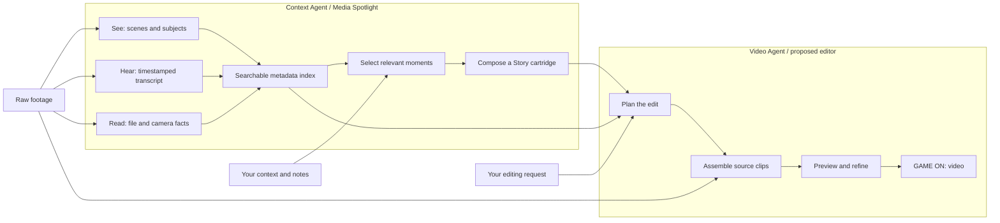

# Video Gaming Agents — the two-agent adventure

**Turn footage into a playable story.**

The audience-facing model is deliberately simple: the **Context Agent** understands the footage and assembles a Story cartridge. The **Video Agent** loads that cartridge, takes a natural-language editing request, and turns a story into a playable video.

The Context Agent is our presentation name for the existing Media Spotlight indexing and Story composition workflow. The Video Agent is the proposed next layer, represented by the retro editor prototype. This deck illustrates that handoff; it does not claim that the editing backend is already connected.

## Recommended extraction DAG

The three extraction branches can be scheduled independently, then joined into the index. This is a recommended conceptual DAG; it is not a claim about the current pipeline's parallel execution. Story composition adds the user's intent to indexed evidence. The rendering stage needs the original media, not just its descriptions.

## The cartridge handoff

Keep the story angle and beats together with their source references. Freeze the Story version and its ordered item list when an edit starts, then resolve positional references to stable asset IDs and source time ranges. An editing request adds duration, aspect ratio, emphasis and style. The Video Agent produces an executable edit plan and a preview; the user can refine it in chat.

Media Spotlight already provides Story JSON, a source manifest, asset metadata and timestamped transcripts. Story `angles`, `shorts` and `beats` are suggestions for a story, not a finished edit timeline. Precise source in/out points, reframing, captions, audio and rendering belong to the Video Agent layer.

## Example quest

Use the real **unbox AI data center** Story. Its exported library has 115 Story items. The demo visually follows the arcade easter egg: **server rooms → unexpected arcade → playful payoff**. The deck uses existing mockup stills; the illustrated preview is a storyboard montage, not a newly edited original-footage video.

## Brainstorm decisions

- Stories are game cartridges, rather than generic folders.
- Context Agent: find meaning. Video Agent: make the movie.
- A chat prompt feels like selecting a quest: "Make a 30-second short. Lead with the arcade surprise."
- The finish state is **GAME ON**, with a preview and an invitation to remix.
- Keep the pitch fun and broad. Source IDs and precise editing details stay in implementation notes.

Open for the next brainstorm: the final product name; whether users choose an angle before loading a cartridge; and whether GAME ON opens a rough cut immediately or waits for a polished export.
