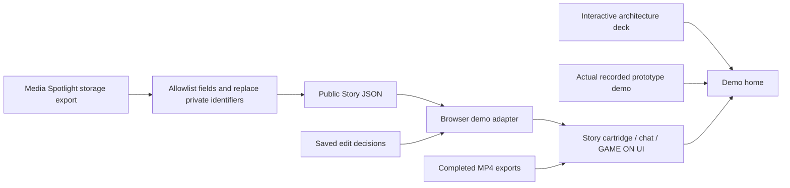

# Frontend architecture

The public frontend preserves the existing retro console UI. It consists of static HTML, CSS, JavaScript, local images/fonts, a sanitized Story snapshot and completed MP4s. Any static HTTP host can serve it.

`frontend/app.js` owns selection, conversation memory, options, context display and playback. `frontend/demo-api.js` provides the original request-shaped interface inside the browser, reading relative static files. It supports Story/context lookup, duration selection, saved plans and completed-output selection. Job log entries describe real local asset loads; they do not imitate live render progress. Reloading a demo run restores it from tab session storage.

Only the two supplied vertical exports are selectable. Aspect ratio, captions and arcade sound are fixed to the packaged files. Unsupported requests receive an explicit message. Provider/API-key settings are replaced with demo information.

The private prototype used a Python server, a read-only Media Spotlight SQLite backup, original footage, FFmpeg and Remotion. Those private dependencies are excluded from this static package. A future live integration can replace `request()` with authenticated backend calls, resolve originals privately and render new outputs. Never publish the private database or raw local path configuration with the frontend.

The local server serves only `public/`, binds to loopback, rejects dotfiles and supports byte ranges for seeking. Static deployment uses relative URLs throughout, including the interactive deck. No network request to Media Spotlight, a model provider or cloud storage occurs in offline demo mode.
